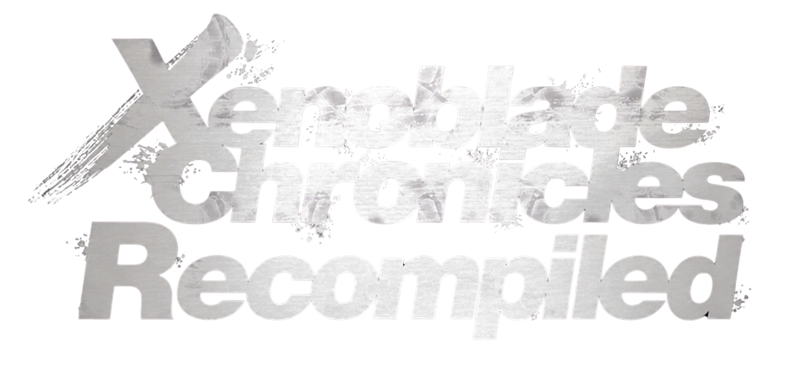

  

  A native PC recompilation project bringing the Xenoblade Chronicles series to Windows.

  
  
  
  
  

  <a href="#project-status">Status</a> ·
  <a href="#development-progress">Progress</a> ·
  <a href="#development-screenshots--comparisons">Screenshots</a> ·
  <a href="#development-roadmap">Roadmap</a> ·
  <a href="#community--contributing">Contribute</a> ·
  <a href="#support-me">Support</a>

## Project Status

**Active development · Windows first · No public release yet**

**Xenoblade Chronicles Recompiled** brings the Xenoblade Chronicles games to Windows as native programs, beginning with **Xenoblade Chronicles: Definitive Edition**.

It uses static ARM64 recompilation to turn the game's original executable code into native PC code, together with a dedicated runtime, a Vulkan graphics implementation and supporting tools. The goal is a fully native Windows experience that needs no emulator or compatibility layer during gameplay.

Development is ongoing, with real progress on the recompilation pipeline, the native runtime, Vulkan rendering and game compatibility. The game is not yet ready for general play, and **there is currently no public build, installer or announced release date.** Development happens in a private repository; the source will be published here once the first game is ready for public testing.

## Development Progress

<!-- progress:start -->

Estimates by area, last updated 2026-11-08. Hand-reviewed estimates per part of the project; bars marked measured come from the code.
<!-- progress:end -->

Xenoblade Chronicles: Definitive Edition has reached the following milestones.

### What's Been Accomplished

- **Static ARM64 recompilation:** A pipeline that converts the game's ARM64 executable modules into native code.
- **Native Windows runtime:** A dedicated runtime that handles the game's execution, memory management and system services.
- **Vulkan graphics:** A native graphics implementation that processes the game's graphics commands, shaders and textures.
- **Native system integration:** Replacements for game SDK hooks and system services, steadily reducing reliance on the transitional Suyu runtime.
- **Title screen:** The native build renders the title screen.
- **Menu navigation:** Scripted controller input navigates the menus.
- **Save loading:** The game detects and loads an existing save.
- **In-game rendering:** The native build reaches Colony 9 and renders the scene, including terrain, character models and HUD.
- **Faster runtime:** Guest threads now run in parallel, the graphics command-recording path is roughly twice as fast, and an opt-in asynchronous submit path overlaps game code with graphics recording. In a stationary Colony 9 scene the native build now runs at roughly 20-25 frames per second, up from under 10 earlier in development.
- **GPU stream-out:** Transform feedback (the GPU stage that generates data such as foliage instances) now runs by default, which fixed the wrong world colours seen without it.

### Current Development Focus

Much work remains before the game is ready for public testing. Current priorities:

- Fixing the remaining graphics and shader issues. I am tracking brief black frames.
- Reaching a stable 30 frames per second (the game's original target), then checking combat, cutscenes and fast movement, which have not been measured yet. Frame pacing still needs work.
- Completing native implementations of remaining system services.
- Refining input, audio, memory management, and save compatibility.
- Testing additional gameplay scenarios and areas.
- Continuing the move away from the modified Suyu compatibility runtime.

## Development Screenshots & Comparisons

These screenshots are real output from internal development builds: side-by-side comparisons of the native renderer against Suyu, and title-screen rendering progress.

### Native Gameplay Progress

The native build loaded an existing save and reached Colony 9. These comparisons show the Suyu reference and the native Vulkan renderer side by side, before and after the character-model fix.

**Update:** The issue that kept character models from appearing in the native renderer is fixed. Graphics work now focuses on overall visual accuracy.

### Title Screen Rendering Progress

Three iterations of the title screen, including fixes for visual artifacts and a temporary color-grading regression.

<table>
  <tr>
    <td align="center" width="33%"></td>
    <td align="center" width="33%"></td>
    <td align="center" width="33%"></td>
  </tr>
</table>

> **These screenshots are outdated.** They were taken from early builds, when rendering was still broken (missing character models, incomplete title screens), and they no longer reflect the current state of development. The project has progressed well beyond what is shown here; newer captures will replace them.
>
> **Note:** All screenshots come from internal development builds and do not represent the final appearance or performance of the project.

## Development Roadmap

The following roadmap outlines the project's current priorities and long-term development plans.

### Phase 1: Native Windows Development

**Status: In Progress**

Continue development of the native Windows implementation, including:

- Static recompilation and executable integration.
- Native operating system and game service replacements.
- Vulkan graphics compatibility and shader translation.
- Rendering accuracy and stability.
- Memory, threading, audio, and input systems.

### Phase 2: Gameplay Compatibility and Optimization

**Status: Planned / Partially Underway**

- Expand testing beyond the current title screen and Colony 9 scenarios.
- Resolve rendering and gameplay compatibility issues.
- Improve runtime performance and resource management.
- Validate save loading and progression.
- Improve stability across different game systems and areas.

### Phase 3: Launcher and Installation System

**Status: Planned, Early Development Work Completed**

Develop a launcher capable of preparing a native game installation using files supplied by the user.

Planned functionality includes:

- User-selected game files and installation directories.
- Local game extraction and preparation.
- Automated recompilation and shader processing.
- Support for compatible game updates and downloadable content.
- Installation management and launching the native executable.

Launcher development is currently a lower priority than completing the native runtime and improving gameplay compatibility.

### Phase 4: Public Source Code and Testing

**Status: Planned**

Once the initial game is sufficiently developed for public testing:

- Publish the project's source code.
- Provide build and installation documentation.
- Make test builds available when they are ready.
- Establish public issue reporting and contribution guidelines.
- Continue development based on testing and feedback.

**No release date has been announced.**

### Phase 5: Additional Xenoblade Chronicles Games

**Status: Future Development**

The current priority is completing Xenoblade Chronicles: Definitive Edition.

Once development of the first game has progressed sufficiently, the project plans to expand to additional titles:

- **Xenoblade Chronicles 2**
- **Xenoblade Chronicles 3**
- **Xenoblade Chronicles X: Definitive Edition**
- **Xenoblade Chronicles 2: Torna – The Golden Country** (potential standalone support)

These are future development targets and are not currently supported.

### Phase 6: Linux Support

**Status: Future Development**

Native Linux support is also planned for the future.

Windows remains the primary development platform while the core runtime and recompilation systems are established.

Linux development will be explored as the project progresses. There is currently no Linux release or announced availability date.

## Community & Contributing

Join the **Xenoblade Chronicles Recompiled Discord server** to follow progress, discuss the project and meet others interested in native recompilation and reverse engineering.

**[Join the Official Discord Server](https://discord.gg/kSXPe7VFhF)**

### Interested in Helping With Development?

**I am currently the sole developer on this project**, and a project of this size involves a great deal of reverse engineering, programming, debugging and testing. If you are an experienced developer and want to help, I would be glad to hear from you.

Help would be especially valuable in these areas:

- **C/C++:** native runtime, systems programming and performance work.
- **Reverse engineering:** ARM64 analysis, executable formats, game internals and Nintendo Switch system interfaces.
- **Graphics:** Vulkan, shader translation and rendering compatibility.
- **Recompilation and tooling:** static recompilation, binary analysis, build systems and development utilities.
- **Testing and debugging:** finding runtime issues, investigating crashes and improving compatibility.

**To get involved, join the Discord server and message me directly ([@Glitxhhh](https://github.com/Glitxhhh)).** We can talk about your experience and the areas you would like to work on, and I can invite suitable contributors to the **private source repository**, where active development takes place. The project is private for now, but it does not have to stay a one-person effort.

## What to Expect

This public repository is the project's official home for information and, later, source code. Until then, expect updates on technical milestones, compatibility improvements and eventual public testing. The source will be published when the first game is ready for the public to test and play.

The planned launcher will create a local installation from game files you provide.

**This project does not distribute copyrighted game files, firmware or encryption keys. Users must supply their own game files.**

## Support Me

I develop this project myself, in my free time alongside my other responsibilities. If you enjoy following my work and want to support me as an individual developer, you can send a voluntary personal donation. Every contribution is appreciated, whatever its size.

### Donation Methods

Cryptocurrency addresses (click to expand)

| Network | Address |
| --- | --- |
| Bitcoin (BTC) | `bc1qnwtms7pp8hdfqnuunvs3juwskgu7tartd532pz` |
| Ethereum (ETH) | `0x48240481C69904C35EC41B4f4eBE41Af05D81975` |
| Solana (SOL) | `8gLiGa61utSAyqRGy4QtoVzP6BNkL3GjQZZBpuRtY8hK` |
| Tron (TRX / USDT-TRC20) | `TDgQTrr4i3ivJQtQpYB5M3nEw92VkAmC6D` |

The Ethereum address is also used on compatible networks including Base, Linea, BNB Chain, Polygon, Optimism, Arbitrum, and Arc. Verify that your wallet is using the correct network before making a transfer.

Donations are voluntary personal gifts to me as an individual developer. They are not payment for the project, a product or a service, and they are not a purchase of, or investment in, the project or any software. They do not give any right to early access, specific features, support, or a release date, and they do not make the project a commercial offering.

## How This Project Is Developed

In the interest of transparency, large language models (LLM coding assistants), including **Claude and Codex**, are involved in this project's development.

These tools assist with code generation, analysis, debugging, research, and implementation of technical components.

I am the project's lead developer and a working programmer. I establish the project's goals, architecture, and technical direction, direct and review the assistants' work, test the results, and make the final decisions regarding implementation.

**AI assistants are development tools used under my direction, not substitutes for developer oversight or engineering decisions.**

  

## License

The original source code of Xenoblade Chronicles Recompiled is licensed under the **GNU General Public License, version 3 or any later version (GPL-3.0-or-later)**.

See [LICENSE](LICENSE) for the full license text.

The license covers only this project's original source code. It does not cover:

- Original game code or copyrighted assets.
- Game dumps, updates, or downloadable content.
- User-provided firmware, encryption keys, or save files.
- Files generated from copyrighted game content.
- Third-party components governed by their own licenses.

For additional information, see [LICENSE-SCOPE.md](LICENSE-SCOPE.md).

---

*Xenoblade Chronicles Recompiled is an independent project developed by Glitxh.*
